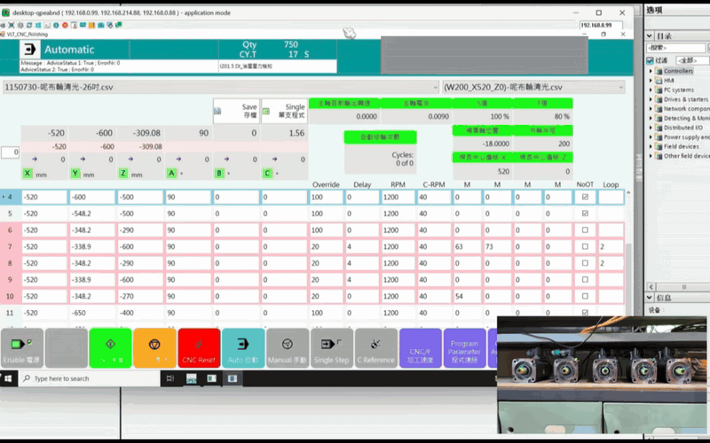

# VLT CNC 拋光系統

> 基於 Siemens SINUMERIK ONE 的五軸 CNC 拋光控制系統，C# 客製化 HMI 整合配方表格、NC 程式自動生成、即時補償與多站協調架構。




> 30 秒實機示範：C# 3GL HMI 依配方表格逐行自動加工，即時顯示五軸座標與目前執行行號；右下角為實際運轉中的伺服馬達。

---

## 概覽

VLT CNC 拋光系統是一套針對工業拋光製程設計的 CNC 客製化控制方案，以 Siemens SINUMERIK ONE 為核心，結合 C# HMI（Create MyHMI / 3GL）實現五軸加工參數管理、NC 程式自動生成與即時電流補償。

| 階段 | 狀態 |
|---|---|
| **單站架構** | 已完成並交付客戶試車 |
| **多站架構**（設計上限 1 主站 + 11 子站） | 已以 1 主站 + 2 台實體 SINUMERIK ONE 子站（虛擬軸）完成跨站交握與控制驗證，目前階段性暫緩 |
| **技術文件與模擬機台** | 已完成系統技術文件與說明簡報，並在公司內建置同規格模擬機台 |

此為**公司私人專案**，本 repo 僅作作品集架構說明用途，不包含原始碼、PLC / NCK 位址對照或任何生產敏感資訊。

📐 **完整系統架構圖（公開版）**：[VLT 五軸拋光機架構](https://kapy0312.github.io/portfolio-next/architecture/vlt.html)

---

## 系統架構

### 單站架構（已交付）

```
┌──────────────────────────────────────────────┐
│        操作端 IPC：SINUMERIK Operate + C# 3GL │
│  配方表格 │ NC 程式產生器 │ 位址對照層 │ 監控 │
└───────────────┬──────────────────────────────┘
                │ FileSvc（搬檔案）／ DataSvc（讀寫變數）
┌───────────────▼──────────────────────────────┐
│            SINUMERIK ONE（NCU）              │
│  NCK：主程式・逐行子程式・CYCLE832・TRAORI   │
│  PLC：M 碼解碼・兩種補償・油壓／潤滑互鎖     │
└───────┬───────────────────────────┬──────────┘
        │ DRIVE-CLiQ                │ PROFINET
┌───────▼─────────────┐   ┌─────────▼────────────────┐
│ SINAMICS S120        │   │ CU240E 變頻器（布輪主軸）│
│ Motor Module × 5     │   │ ET200SP（油壓、潤滑 IO） │
└───────┬─────────────┘   └─────────┬────────────────┘
        │                           │
┌───────▼───────────────────────────▼──────────┐
│     五軸拋光機台：X / Y / Z / B / C + 布輪    │
└──────────────────────────────────────────────┘
```

伺服走 **DRIVE-CLiQ**、布輪變頻器與週邊 IO 走 **PROFINET**，兩條網路互不相干。現場查修的第一步就是先分清楚：伺服不動查 DRIVE-CLiQ，布輪不轉查 PROFINET。

### 多站架構（已驗證 1 主站 + 2 子站，階段性暫緩）

```
┌──────────────────────────────────────────────┐
│        C# 3GL HMI（共用監控頁面）            │
│  站號下拉選單 │ 模式切換 │ NC 程式管理 │ 監控 │
└───────────────┬──────────────────────────────┘
                │ DataSvc / FileSvc
┌───────────────▼──────────────────────────────┐
│             主站 SINUMERIK ONE               │
│  HMI 資料交換區（各子站資料彙整）            │
│  同步控制區（全站廣播命令）                  │
└──┬────────────────────────────────────────┬──┘
   │ S7 GET / PUT（PROFINET）               │
┌──▼─────────────┐                ┌─────────▼──────┐
│ 子站 1 ~ 6     │     . . .      │ 子站 7 ~ 11    │
│ SINUMERIK ONE  │                │ SINUMERIK ONE  │
│ 同構資料區     │                │ 同構資料區     │
└────────────────┘                └────────────────┘
```

---

## 加工流程（單站）

從操作員填好一行配方，到布輪真的貼著工件拋光：

| 步驟 | 發生什麼事 |
|---|---|
| 1. 填配方 | 在 HMI 表格逐行填座標、進給、布輪轉速、C 軸轉速、M 碼 |
| 2. 產生程式 | 程式產生器依加工模式（單支、多支、修輪、刀尖跟隨…）組出 NC 副程式 |
| 3. 下載 | 透過 FileSvc 把副程式放進 NCK，覆蓋上一版 |
| 4. 啟動 | 透過 DataSvc 對 PLC 面板按鍵送出脈衝，等同按下 Cycle Start |
| 5. 路徑平滑 | 主程式先開啟 CYCLE832，再呼叫加工副程式 |
| 6. 逐行執行 | 每一行呼叫一次逐行子程式並回報行號，HMI 才知道跑到第幾行 |
| 7. 刀尖換算 | TRAORI 依加工模式把接觸點座標換算成實體軸位置 |
| 8. 驅動 | NCK 插補後經 DRIVE-CLiQ 驅動五軸伺服；M 碼與轉速交給 PLC，經 PROFINET 送到變頻器帶動布輪 |

加工中兩種補償持續微調；HMI 收到程式結束回報後，會自動接下一支，或在計數到達時切入修輪程式。

---

## 核心功能

### 五軸拋光控制

- **雙模式拋光**：定位拋（C 軸只定位，五軸同動插補）與環拋（C 軸持續旋轉，改用虛擬軸插補讓接觸點固定），依製程需求切換
- **無頓點 NC 程式**：M 碼與插補指令同行，布輪轉速只在數值變化時才寫入，消除加工路徑頓點
- **配方表格化**：以 CSV 表格管理加工步序，逐列自動生成 NC 程式，操作員不需要會寫 G-Code

### 即時補償

| 補償 | 改的是什麼 | 原理 |
|---|---|---|
| **電流補償** | 位置 | 布輪負載電流偏離基準，就沿刀具方向把布輪推近或拉遠，自動修正磨耗 |
| **線速度補償** | 轉速 | 布輪磨小、表面速度下降，就提高轉速維持拋光均勻 |

### HMI 架構

- **位址對照層**：畫面程式只使用邏輯名稱，不直接寫死 NCK / PLC 位址；換機種或擴充多站時只需改對照表
- **軸座標訂閱**：以持續訂閱取代輪詢，搭配時間濾波降低畫面閃動
- **管理員 / 操作員**分級權限
- **實務踩坑紀錄**：整理 DataSvc 型別轉換的陷阱（特定型別寫入失敗、REAL 讀回為位元排列等），收錄於系統技術文件

### 多站協調控制（階段性暫緩）

- **1 主站 + 11 子站**：HMI 只連主站，透過 S7 GET / PUT 間接存取所有子站
- **共用監控頁面**：以下拉選單切換站號，沿用單站監控邏輯，HMI 改動最小
- **防衝突切站**：切站期間鎖定操作，資料同步完成才開放
- **全站廣播（站號 99）**：以 POKE_BLK 一次把命令寫入所有子站，支援全線同步啟動 / 停止
- **NC 程式派送**：依站號對應 IP，自動將 NC 程式推送到對應子站
- **同構資料區**：所有站共用相同結構（P 段：HMI 寫入的命令與設定；R 段：PLC 回寫的狀態與座標），C# 端以單一位址計算邏輯處理所有站

### 多站資料流向

```
子站 NCK 變數
  → 子站 PLC（批次讀取鏡像）
    → 子站資料區
      → 主站 PLC（GET）
        → 主站 HMI 資料交換區
          → HMI DataSvc 讀取
```

---

## 通訊架構

| 通訊層 | 技術 | 說明 |
|---|---|---|
| HMI ↔ NCK / PLC | Siemens Operate Services DataSvc | 讀寫變數、面板按鍵、訂閱座標 |
| HMI → NCK | FileSvc | NC 副程式下載 |
| HMI → 子站 | SFTP（WinSCP） | 多站 NC 程式派送 |
| NCU ↔ 伺服 | DRIVE-CLiQ | S120 五軸驅動 |
| PLC ↔ 變頻器 / IO | PROFINET | CU240E 布輪主軸、ET200SP 週邊 |
| 主站 ↔ 子站 | S7 GET / PUT（PROFINET） | 跨站資料同步，按需觸發 |

---

## 技術選型

| 層 | 技術 | 說明 |
|---|---|---|
| CNC 控制器 | Siemens SINUMERIK ONE | 單站 × 1（已交付）/ 主站 × 1 + 子站 × 2 驗證（設計上限 11 站，暫緩） |
| 運動控制 | TRAORI・CYCLE832 | 五軸刀尖跟隨、路徑平滑 |
| PLC 程式 | TIA Portal SCL / LAD | M 碼解碼、補償運算、互鎖、跨站通訊 |
| 驅動 | SINAMICS S120 / CU240E-2 | 五軸伺服 / 布輪變頻 |
| HMI 框架 | C# Windows Forms（Create MyHMI / 3GL） | Siemens Operate Services 整合 |
| NC 程式傳輸 | FileSvc / WinSCP（SFTP） | 單站下載 / 多站派送 |
| 開發環境 | Visual Studio 2022 x86 | .NET 4.8 |

---

## 我的參與角色

本專案由多方協作完成，包含 Siemens 原廠工程師技術支援及內部團隊協作。我主要負責的範疇：

- PLC 通訊邏輯實作與除錯（TIA Portal SCL）——跨站 GET / PUT 資料同步、POKE_BLK 全站廣播
- C# 3GL HMI 開發——多站切換與防衝突邏輯、站號路由、DataSvc 相關問題排除
- NC 程式自動生成引擎（CSV 表格 → NC code）與多站派送整合
- 現場試車協調與問題排除
- **技術文件**：撰寫系統說明簡報與技術手冊（架構、加工流程、補償原理、常見問題、檢核清單）
- **模擬機台建置**：以相同控制器與配線在公司內重建現場環境，供同仁學習與維護，也用於新人伺服調機練習

---

*Built with [Kevin Lai](https://github.com/kapy0312) — 私人公司專案，架構說明用途 · [作品集網站](https://kapy0312.github.io/portfolio-next/)*
